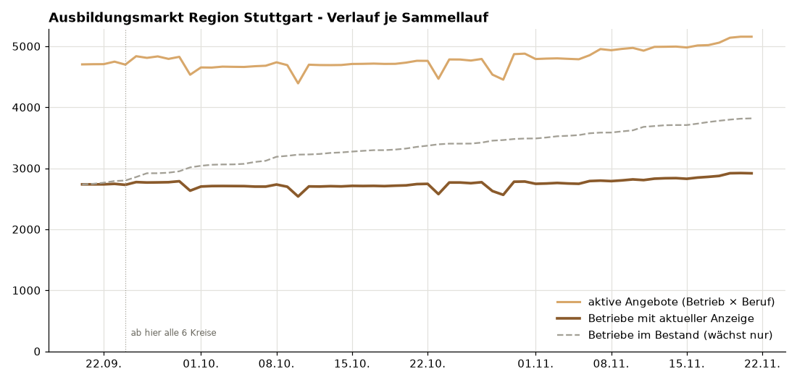
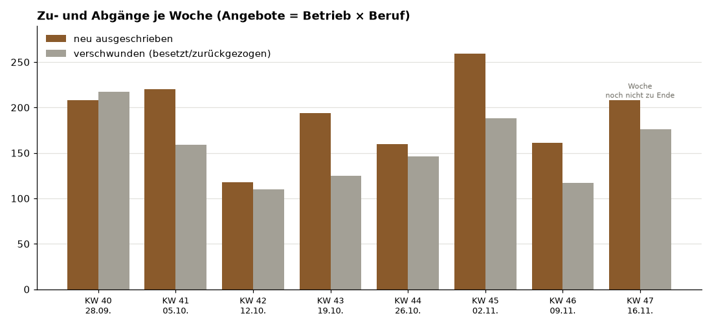
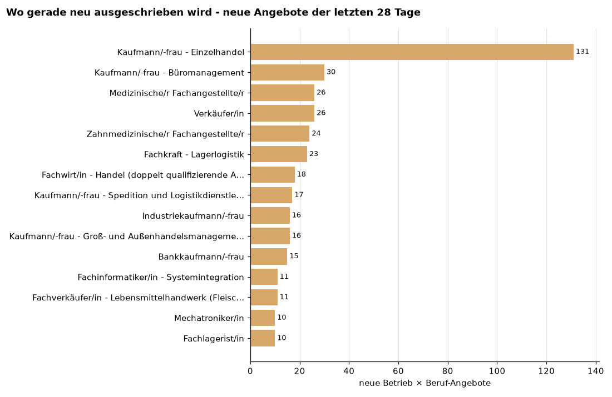

# Ausbildungsmarkt Region Stuttgart - Auswertung

Stand: **2026-11-21** · automatisch erzeugt von `scripts/auswertung.py` aus `daten/betriebe.json`
und `daten/laeufe.jsonl`. Nur Betriebe in Baden-Württemberg (Region Stuttgart).

## Auf einen Blick

| Kennzahl | Wert |
|---|---:|
| Betriebe im Bestand | 3.608 |
| davon mit aktueller Anzeige | 2.916 |
| davon **ohne aktuelle Anzeige** (Initiativbewerbung) | 692 |
| aktive Angebote (Betrieb × Beruf) | 5.156 |
| verschiedene Berufe mit aktiver Anzeige | 824 |
| Angebote mit Beginn schon erreicht (sofort/Restplätze) | 497 |
| Angebote für Beginn 2027 | 4.633 |
| Betriebe mit Anzeige: 2026-09-28 → 2026-11-21 | 2.771 → 2.917 (+146) |

## Zu- und Abgänge der letzten vollen Wochen

| Woche ab | neu ausgeschrieben | verschwunden | Saldo |
|---|---:|---:|---:|
| 19.10.2026 (KW 43) | 194 | 125 | +69 |
| 26.10.2026 (KW 44) | 160 | 146 | +14 |
| 02.11.2026 (KW 45) | 259 | 188 | +71 |
| 09.11.2026 (KW 46) | 161 | 117 | +44 |

## Grafiken

## Lesehilfe

- **Angebot** = ein Betrieb mit einem Ausbildungsberuf. Mehrere Anzeigen desselben Betriebs
  für denselben Beruf zählen einmal - das misst die Breite des Marktes, nicht die Zahl der Plätze.
- **Aktiv** = beim letzten Sammellauf noch in der BA-Jobsuche zu finden.
- **Verschwunden** heißt: seit dem Tag nicht mehr gesehen. Meist besetzt oder zurückgezogen -
  die BA sagt nicht, welches von beiden.
- Wochenwerte beginnen am 28.09.2026; davor hat sich der Bestand erst aufgebaut.
- `gefundeneStellen` in `laeufe.jsonl` zählt Treffer je Ort - die Umkreise überlappen, eine
  Anzeige kann also mehrfach darin stecken. Für Trends `aktiveBetriebe`/`aktiveAngebote` nehmen.
